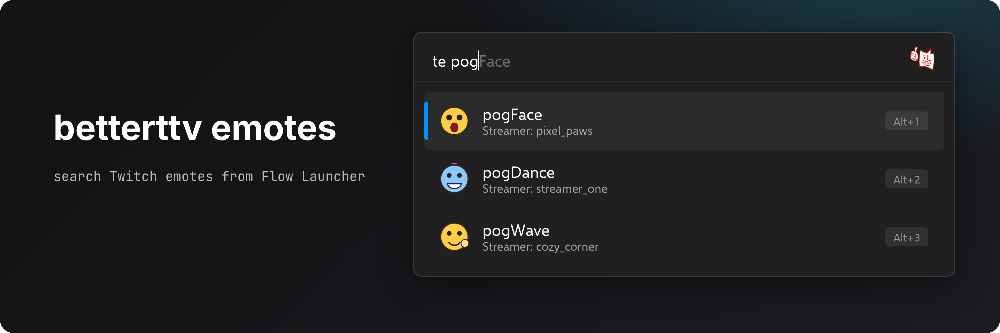

<!-- generated by readwright from docs/README.md.j2; edit the template, not this file -->


# BetterTTV Twitch Emotes

Search Twitch.tv emotes via BetterTTV from Flow Launcher.

[](https://github.com/Garulf/BetterTTV-Twitch-Emotes/actions/workflows/tests.yml) [](https://github.com/Garulf/BetterTTV-Twitch-Emotes/releases/latest)

[](https://www.buymeacoffee.com/garulf) [](https://github.com/sponsors/Garulf)

## Features

* **Search shared emotes.** Find BetterTTV emotes by name.
* **Top emotes.** Leave the search empty to see the most used emotes.
* **One key to copy.** `Enter` copies the emote's image link, ready to paste into chat or Discord.
* **Quick actions.** Open the emote in your browser from the context menu.

## Usage

Type `te` followed by at least three characters of an emote name:

```
te pog
```


Type `te` on its own to list the top emotes. They are refreshed every five minutes:


| Key | Action |
| --- | --- |
| `Enter` | Copy the emote's image link |
| `Shift+Enter` | Context menu: open the emote in your browser or copy its link |

## Installation

### Flow Launcher

In Flow Launcher, type:

```
pm install betterttv-twitch-emotes
```


### Manual installation

Download `BetterTTV-Twitch-Emotes-<version>.zip` from the [latest release](https://github.com/Garulf/BetterTTV-Twitch-Emotes/releases/latest) and unzip it into
`%appdata%\FlowLauncher\Plugins`, then restart Flow Launcher.

Pre-releases of the next version are published from the open release PR on the
[releases page](https://github.com/Garulf/BetterTTV-Twitch-Emotes/releases) for testing. Flow Launcher won't offer them as updates.

## Requirements

* Flow Launcher 1.17.0 or newer
* Python 3.8 or newer, which Flow Launcher can install for you
